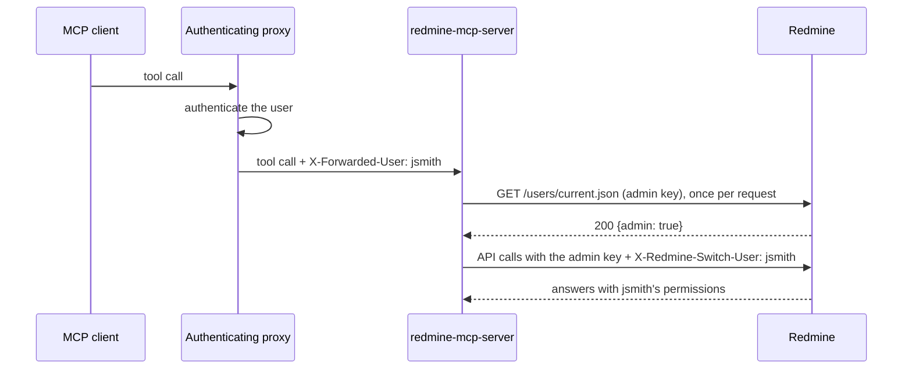

# trusted-header auth mode

## What it is

`REDMINE_AUTH_MODE=trusted-header` runs every request as the Redmine user that
an authenticating proxy in front of this server names in a request header. The
proxy, for example an SSO gateway or a reverse proxy that handles login, has
already authenticated the user. The server then calls Redmine with one
administrator API key plus `X-Redmine-Switch-User: <login>`, Redmine's built-in
user impersonation, so each request runs with that user's own permissions.

It needs no OAuth on Redmine and no API key from any user, and it works with
Redmine 4.0 or newer.



## When to use it

Use `trusted-header` when a proxy that already knows who the user is sits in
front of this server, for example a gateway that publishes several MCP servers
behind one login. Every user then gets the access they have in the Redmine web
interface, and nobody handles an API key.

If users connect to this server directly, use another mode: `oauth-proxy` on
Redmine 6.1 or newer, `api-key-login` otherwise.

## Configuration

Minimal `.env`:

```bash
REDMINE_AUTH_MODE=trusted-header
REDMINE_URL=https://redmine.example.com
REDMINE_API_KEY=<API key of a Redmine administrator>
REDMINE_TRUSTED_HEADER_TRUST_PROXY=true
```

| Variable | Default | Notes |
|---|---|---|
| `REDMINE_AUTH_MODE=trusted-header` | `legacy` | activates the mode |
| `REDMINE_API_KEY` | required | the key of a Redmine administrator; see [The administrator key](#the-administrator-key) |
| `REDMINE_TRUSTED_HEADER_TRUST_PROXY` | `false` | required; operator attestation, see [Security requirements](#security-requirements) |
| `REDMINE_TRUSTED_HEADER_NAME` | `X-Forwarded-User` | the request header that names the user |
| `REDMINE_TRUSTED_HEADER_MATCH` | `login` | `login`: the header carries the Redmine login. `mail`: it carries an email address; see [Matching by email](#matching-by-email) |

The server refuses to start without `REDMINE_URL`, `REDMINE_API_KEY` or the
attestation flag, with an unknown `REDMINE_TRUSTED_HEADER_MATCH`, or unless
Redmine confirms at startup that the key belongs to an administrator. It does
not start while Redmine cannot be reached; with a container restart policy, it
comes up once Redmine answers.

## Security requirements

The server cannot tell a header the proxy set from one a client forged: anyone
who can send it a request can claim to be any Redmine user. Setting
`REDMINE_TRUSTED_HEADER_TRUST_PROXY=true` attests that:

- **only the proxy can reach the server.** Do not publish its port. Keep it on a
  network that only the proxy shares, or firewall it.
- **the proxy sets the header on every request**, overwriting any value a client
  sent, and forwards no request it has not authenticated.

A request without the header, or with a value that cannot be a Redmine login
(or an email address in `mail` mode), is refused. The server never runs a
request as the administrator itself.

## The administrator key

Redmine honours `X-Redmine-Switch-User` only when the API key belongs to an
administrator. For any other key it ignores the header without an error, and
the request runs as the key's own account. So:

- the server refuses to start unless Redmine confirms that the key belongs to
  an administrator;
- it checks again once per request, so if the account loses that role while the
  server runs, requests are refused from then on instead of running as the
  key's own account.

Treat the key like a root password: whoever holds it can act as any Redmine
user. Use a dedicated administrator account for it, so that Redmine's log lines
`User switched by: <account>` name the server. The key is never logged.

Users named in the header who are Redmine administrators run with
administrator rights, as they do in the Redmine web interface: Redmine skips
its permission checks for them.

## Matching by email

With `REDMINE_TRUSTED_HEADER_MATCH=mail`, the header carries an email address,
which is what most login proxies know. The server looks the user up once per
request:

- the address must equal the **primary** email of an **active** Redmine user,
  ignoring case. Additional email addresses do not count;
- exactly one user must match, otherwise the request is refused;
- the lookup costs one more Redmine call per request.

This mode trusts the email addresses stored in Redmine. Redmine keeps them
unique, so nobody can claim an address another account already uses. But if
users can change their own email, someone could claim an address that is not in
Redmine yet, and requests from the person who owns it would run as that
account. Let administrators manage email addresses, or sync them from your
directory.

## Cutting off a user

- **In Redmine:** lock the account. Redmine refuses to switch to a locked user,
  so the user's requests fail at once.
- **At the proxy:** remove or disable the user in your identity provider, so the
  proxy stops forwarding their requests.

The server keeps no sessions or keys of its own, so it needs no action.

## Errors users may see

Each comes back with the code `PER_USER_AUTH`:

| Message | Cause |
|---|---|
| missing `<header>` request header | the request did not come through the proxy, or the proxy sets another header |
| the `<header>` header is not a valid Redmine login (or email address) | the value cannot name a Redmine user |
| that login does not exist in Redmine or the account is locked | Redmine refused the switch (HTTP 412) |
| no active Redmine user has the email ... | `mail` mode found no matching user |
| ... requires REDMINE_API_KEY to belong to a Redmine administrator ... | the key's account is no longer an administrator |

If Redmine cannot be reached, tools return the usual connection or timeout
error.

## Relationship to read-only mode

`REDMINE_MCP_READ_ONLY=true` works as in every mode: write tools are blocked for
everyone, whatever their Redmine permissions.

## Health check

`/health` checks the administrator key with `GET /users/current.json`, as in
legacy mode.

## Troubleshooting

See the [trusted-header section of the troubleshooting guide](troubleshooting.md#trusted-header).
